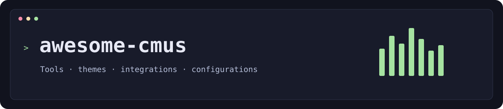

# Awesome cmus

A curated list of cmus tools, integrations, themes, configurations, and learning resources.

[cmus](https://cmus.github.io/) is a small console music player for Unix-like systems. Most extensions connect through `cmus-remote`, status hooks, or MPRIS; audio input/output plugins are a separate extension mechanism.

## Contents

- [Official resources](#official-resources)
- [Lyrics](#lyrics)
- [Artwork](#artwork)
- [macOS integration](#macos-integration)
- [Visualization](#visualization)
- [Scrobbling and history](#scrobbling-and-history)
- [Discovery and playlists](#discovery-and-playlists)
- [Search and application integration](#search-and-application-integration)
- [tmux and sessions](#tmux-and-sessions)
- [Notifications](#notifications)
- [Desktop bars and MPRIS](#desktop-bars-and-mpris)
- [Discord presence](#discord-presence)
- [Web and mobile](#web-and-mobile)
- [Synchronization](#synchronization)
- [Library tools and audio processing](#library-tools-and-audio-processing)
- [Themes](#themes)
- [Configurations](#configurations)
- [Scripts](#scripts)
- [Download utilities](#download-utilities)
- [Development](#development)
- [Articles and tutorials](#articles-and-tutorials)
- [Related implementations](#related-implementations)
- [Detailed guides](#detailed-guides)
- [Historical resources](#historical-resources)
- [Contributing](#contributing)
- [License](#license)

## Official resources

- [Bindable scripts](https://github.com/cmus/cmus/wiki/shell-scripts) - Programs invoked from within cmus through `shell` and `run`.
- [cmus](https://github.com/cmus/cmus) - Small, fast console music player for Unix-like systems, with build instructions and source code.
- [cmus manual](https://github.com/cmus/cmus/blob/master/Doc/cmus.txt) - Commands, settings, filters, format strings, audio plugins, and MPRIS.
- [cmus tutorial](https://github.com/cmus/cmus/blob/master/Doc/cmus-tutorial.txt) - Introduction to the library, playlists, queue, search, and playback modes.
- [cmus-remote](https://github.com/cmus/cmus/blob/master/Doc/cmus-remote.txt) - External controls, metadata queries, and commands for scripts and integrations.
- [Extension wiki](https://github.com/cmus/cmus/wiki) - Original community catalog.
- [Status display programs](https://github.com/cmus/cmus/wiki/status-display-programs) - Hook-based integrations and instructions for combining them.

## Lyrics

- [bash-lyrics](https://github.com/mihaiolteanu/bash-lyrics) - Downloads and saves lyrics, builds a searchable collection, and can play songs found through that collection.
- [clyrics](https://github.com/trizen/clyrics) - Extensible Perl fetcher with cmus, MOC, and playerctl daemon modes.
- [cmus-auto-lyrics](https://github.com/sparklost/cmus-auto-lyrics) - Curses lyrics viewer with scrolling, timestamps, embedded tags, offline mode, and tmux launcher examples.
- [cmus-liner](https://github.com/OliverHofkens/cmus-liner) - Rust companion showing embedded lyrics and local cover art.
- [cmus-lyric](https://github.com/index-null/cmus-lyric) - Go TUI with synchronized lyrics, local and embedded sources, translations, caching, artwork, and Homebrew installation.
- [cmus-smart-lyrics](https://github.com/italrr/cmus-smart-lyrics) - Inspired by hakerdefo's implementation, with standalone and tmux examples.
- [guxsousa/cmus-lyrics](https://github.com/guxsousa/cmus-lyrics) - Separate fetching implementation worth inspecting for scripting ideas.
- [hakerdefo/cmus-lyrics](https://github.com/hakerdefo/cmus-lyrics) - Relatively simple shell-based fetcher for the current track.
- [lrcsnc](https://github.com/Endg4meZer0/lrcsnc) - Player-independent synchronized lyrics through MPRIS.
- [lyriccli](https://github.com/Openmentia/lyriccli) - Minimal command-line lyrics companion with cmus support.
- [lyrus](https://github.com/Ja4e/lyrus) - Curses companion supporting cmus, local text and LRC files, and automatic fetching.
- [lyvi](https://github.com/ok100/lyvi) - Terminal viewer with artwork and synchronized LRC support.
- [show-lyrics](https://github.com/alewmoose/show-lyrics) - Terminal lyrics viewer with cmus support.
- [wdog/cmus_lyrics](https://github.com/wdog/cmus_lyrics) - Fetches Genius lyrics into the terminal.

## Artwork

- [cmus-artwork](https://github.com/mitrovicstefan/cmus-artwork) - Pixelated terminal artwork with playback controls.
- [cmus-cover-art](https://github.com/nogizhopaboroda/cmus-cover-art) - Extracts artwork and displays it through a configurable image viewer.
- [cmus-feh.sh](https://github.com/TiredSounds/cmus-scripts/blob/master/cmus-feh.sh) - Displays artwork in a separate feh window.
- [cmus-sixel](https://github.com/emp1r3/cmus-sixel) - POSIX shell cover-art helper using FFmpeg and img2sixel.
- [cmus-swift](https://github.com/Coreball/cmus-swift) - Native macOS artwork window with familiar playback and seeking controls.
- [cmus_cover_art](https://github.com/Vizkid04/cmus_cover_art) - Rust artwork helper for Kitty, with a demonstrated tmux and CAVA layout.
- [cmus_sixel](https://github.com/S22F5/cmus_sixel) - C status program displaying covers through Sixel or Kitty graphics.
- [cmusCoversSDL](https://github.com/LaurentFough/cmusCoversSDL) - SDL2 cover-art viewer; surviving fork of the original wiki-linked project.
- [cmusf](https://github.com/kushagraa-j/cmusf) - Small shell utility for fetching the current song's cover.
- [cmusinfo](https://github.com/arisu-gh/cmusinfo) - Multitool for status output, desktop notifications, and artwork through mpv.
- [Gunqqer's musicScripts](https://github.com/gunqqer/musicScripts) - Artwork scripts using w3m or viu, plus a music-sorting script.
- [TiredSounds/cmus-conky](https://github.com/TiredSounds/cmus-conky) - Displays track information and artwork in Conky.
- [TiredSounds/cmus-scripts](https://github.com/TiredSounds/cmus-scripts) - Collection of small companion scripts.

## macOS integration

- [cmus-control](https://github.com/TheFox/cmus-control) - Dedicated macOS media-key daemon with Homebrew and service instructions.
- [cmus-osx](https://github.com/PhilipTrauner/cmus-osx) - Track-change notifications and media-key support.
- [cmusie](https://github.com/nkanaev/cmusie) - Menu-bar app with playback controls and media-key integration.
- [Raycast cmus scripts](https://github.com/raycast/script-commands/tree/master/commands/media/cmus) - Existing actions for play/pause, previous/next, shuffle, repeat, and track information.
- [SketchyBar](https://github.com/FelixKratz/SketchyBar) - macOS status-bar framework that can be wired to cmus; requires custom integration.
- [xbar cmus plugin](https://github.com/matryer/xbar-plugins/blob/44180ccde9372a830db2702a57b32f03572e02b2/Music/cmus.10s.sh) - Menu-bar track information and controls; older terminal-launch APIs may need adaptation.

## Visualization

- [BlackHole](https://github.com/ExistentialAudio/BlackHole) - macOS loopback driver for routing audio between applications when your capture setup needs it.
- [CAVA](https://github.com/karlstav/cava) - Spectrum bars for a terminal or SDL window.
- [cmusfetcher500](https://github.com/CreativeCodeCat/cmusfetcher500) - Launches CAVA and feh alongside cmus.
- [roistaff/cmus-plugins](https://github.com/roistaff/cmus-plugins) - Artwork integration with a CAVA setup whose bar colors change with the cover.
- [spectroterm](https://github.com/sparklost/spectroterm) - Terminal analyzer with axes, peak markers, configurable frequency ranges, colors, and PipeWire/PulseAudio support.

## Scrobbling and history

- [cmus-status-scrobbler](https://github.com/vjeranc/cmus-status-scrobbler) - Python scrobbler with multiple services, offline storage, MusicBrainz IDs, and pause handling.
- [cmusfm](https://github.com/arkq/cmusfm) - C scrobbler with now-playing updates, offline caching, configurable services, filename parsing, and optional notifications.
- [ListenBrainz integration directory](https://listenbrainz.org/add-data/) - ListenBrainz itself lists cmus-status-scrobbler as a cmus integration.
- [ListenBrainz shell submitter](https://community.metabrainz.org/t/checking-minimal-json-submission/723460) - Author discussion and shell example with recording IDs and offline logging.
- [lolfm](https://github.com/jimd1989/lolfm) - Local SQLite listening-history database with loved tracks, SQL analysis, reporting helpers, and historical Last.fm import notes.

## Discovery and playlists

- [beets Smart Playlist](https://beets.readthedocs.io/en/stable/plugins/smartplaylist.html) - Generates playlist files from metadata queries.
- [cmus-dynamiclistfm](https://github.com/guxsousa/cmus-dynamiclistfm) - Builds playlists from a seed song or playlist, matches against the local library, and lets you choose playlist size.
- [cmus-shuffled-albums](https://github.com/kidsil/cmus-shuffled-albums) - Generates a playlist containing a limited number of randomly selected complete albums.
- [cmus_lastfm_autoadd](https://github.com/weisslj/cmus_lastfm_autoadd) - Fills the playlist or queue with similar tracks using Last.fm information.

## Search and application integration

- [blayc](https://github.com/gontoblez/blayc) - Script for interacting with cmus without switching to its window.
- [cmus-fzf](https://github.com/itsjfx/cmus-fzf) - Fuzzy selection from your cmus library.
- [cmus.nvim](https://github.com/cmus-enjoyers/cmus.nvim) - Dedicated Neovim integration, described by its author as work in progress.
- [fish-cmus-utils](https://github.com/fzuellich/fish-cmus-utils) - Fish helper providing a playback-toggle function.
- [FZF snippets gist](https://gist.github.com/igemnace/9b6fb8c2885c3e35299b3a122e1009e5) - Includes a music picker and aliases.
- [gotbletu fzf queue picker](https://github.com/gotbletu/shownotes/blob/d458da0c38bbbd8e6934827d260f3bd6a9272dc5/fzf_nova/_cmus) - Multi-select songs with fzf, replace the queue, and start playback.
- [nnn's cmusq plugin](https://github.com/jarun/nnn/blob/master/plugins/cmusq) - Sends files and directories from nnn into cmus.
- [player.nvim](https://github.com/alexxGmZ/player.nvim) - Neovim controls through playerctl/MPRIS, with cmus among configurable players.
- [ranger-cmus](https://github.com/maximtrp/ranger-cmus) - Adds commands to play files or folders, add them to the library, or enqueue them.
- [rofi-cmus](https://github.com/vojdel/rofi-cmus) - Rofi frontend for selecting music without opening the full cmus interface.
- [vim-cmus](https://github.com/azadkuh/vim-cmus) - Controls the player directly from Vim.

## tmux and sessions

- [Detachable cmus guide](https://github.com/cmus/cmus/wiki/detachable-cmus) - tmux and screen approaches, including changing `q` into a detach action.
- [Mpdreamz/tmux-cmus](https://github.com/Mpdreamz/tmux-cmus) - Status widget with truncation and playback keybindings.
- [tmux-cmus-status](https://github.com/JenGoldstrich/tmux-cmus-status) - Separate fields for artist, title, and playback state, plus F7/F8/F9 controls.
- [tmux-player-ctl](https://github.com/kesor/tmux-player-ctl) - Popup controller for MPRIS players using playerctl.

## Notifications

- [0x61nas/cmus-notify](https://github.com/0x61nas/cmus-notify) - Rust notifications for track, volume, and mode changes; author labels it early-stage.
- [AntoineGagne/cmus-notify](https://github.com/AntoineGagne/cmus-notify) - Python notification program.
- [cmus-status-line](https://github.com/Noah2610/cmus-status-line) - Configurable playback information written to stdout, including progress formatting.
- [cmus_notify.py](https://gist.github.com/EmmaSimon/a617df1b86c558162e4c934ff65cebe1) - GNOME notifications with artwork and playback buttons.
- [cmushnotify](https://github.com/Dimithrandir/cmushnotify) - Shell notifications with artwork.
- [CmusNotify](https://github.com/sebojanko/CmusNotify) - Go implementation for now-playing notifications.
- [dcx86r/cmus-notify](https://github.com/dcx86r/cmus-notify) - Configurable Perl and notify-send implementation, with optional artwork and Dunst-related settings.
- [mathieu-lemay/cmus-notify](https://github.com/mathieu-lemay/cmus-notify) - Small Rust application supporting local cover images.
- [VonHeikemen/cmus-notify](https://github.com/VonHeikemen/cmus-notify) - Lightweight notify-send script.

## Desktop bars and MPRIS

- [cmus-polybar](https://github.com/the-anonymous-raven/cmus-polybar) - Alternative module with progress indicators.
- [cmus-waybar](https://github.com/imagineeeinc/cmus-waybar) - Small Nim helper producing current-track information for Waybar.
- [gnome-cmus-status](https://github.com/GregTheMadMonk/gnome-cmus-status) - GNOME Shell extension for display and control.
- [go-cmus-polybar-status](https://github.com/ma3ke/go-cmus-polybar-status) - Go formatter showing playback, title, and progress.
- [go-playerctl](https://github.com/arran4/go-playerctl) - Go CLI, library, daemon, and TUI for MPRIS media players.
- [pgaskin/barlib](https://github.com/pgaskin/barlib) - Event-driven MPRIS status and controls, with a cmus module and window actions.
- [playerctl](https://github.com/altdesktop/playerctl) - General media-control CLI.
- [polybar-cmus](https://github.com/raytruong/polybar-cmus) - Status script for Polybar.
- [py3status cmus module](https://ultrabug.github.io/py3status/user-guide/modules/#cmus) - Existing module with formatting and mouse controls.
- [stumpwm-cmus](https://github.com/jdfight/stumpwm-cmus) - StumpWM module.

## Discord presence

- [Bond-009/cmus-discord-rpc](https://github.com/Bond-009/cmus-discord-rpc) - Rust implementation dedicated to cmus.
- [cmus-rpc-c](https://github.com/ZirixCZ/cmus-rpc-c) - C implementation using the Discord Game SDK.
- [cmus-rpc-py](https://github.com/sparklost/cmus-rpc-py) - Configurable Discord presence with progress, artwork, buttons, and filename parsing.
- [discordrp-mpris](https://github.com/FichteFoll/discordrp-mpris) - Generic MPRIS integration.
- [FawkesOficial/cmus-discord-rpc](https://github.com/FawkesOficial/cmus-discord-rpc) - Python client.
- [mesalilac/cmus-rpc](https://github.com/mesalilac/cmus-rpc) - Rust implementation.
- [pascalpuffke/cmus-rich-presence](https://github.com/pascalpuffke/cmus-rich-presence) - Standalone provider.
- [pascalpuffke/cmusrp-rust](https://github.com/pascalpuffke/cmusrp-rust) - Separate Rust implementation.
- [saibakho/cmrpc](https://github.com/saibakho/cmrpc) - Additional cmus Discord RPC project.
- [Scallion3008/cmus-discord-rich-presence](https://github.com/Scallion3008/cmus-discord-rich-presence) - Another dedicated implementation.
- [YellowCoat1/cmus-drp](https://github.com/YellowCoat1/cmus-drp) - Small Rust provider.

## Web and mobile

- [cmus-android](https://github.com/pgaskin/cmus-android) - Actual Android port with touch controls, artwork, system media integration, sleep timer, and state management.
- [cmus-notifier](https://gitlab.com/castluno/cmus-notifier) - Termux notification controls; development moved to GitLab.
- [cmus-web](https://github.com/FawkesOficial/cmus-web) - Self-hosted browser and PWA remote with live state, artwork, seeking, and playback controls.
- [ichier/cmus_app](https://github.com/ichier/cmus_app) - Fork of the older Bottle-based web remote.
- [Tosh](https://github.com/qrti/tosh) - Touch overlay for terminal applications, demonstrated as a Raspberry Pi cmus player.

## Synchronization

- [beets Play plugin](https://beets.readthedocs.io/en/stable/plugins/play.html) - Passes query results to a configurable player command as a playlist or file arguments.
- [beets-cmusupdate](https://github.com/natezb/beets-cmusupdate) - Adds newly imported beets tracks to cmus; check compatibility with current beets versions.
- [cmus-sync](https://github.com/samhal/cmus-sync) - Older playlist-driven device synchronization script.
- [cmus-syncthing](https://github.com/Kaleb0x/cmus-syncthing) - Exports playlists and corresponding tracks into a directory that Syncthing can transfer.

## Library tools and audio processing

- [beets](https://beets.readthedocs.io/en/stable/) - Organizes files, corrects metadata, and provides a searchable music database.
- [beets Duplicates](https://beets.readthedocs.io/en/stable/plugins/duplicates.html) - Finds duplicate tracks or albums.
- [beets EmbedArt](https://beets.readthedocs.io/en/stable/plugins/embedart.html) - Embeds artwork in audio files, so the art can travel with individual tracks.
- [beets FetchArt](https://beets.readthedocs.io/en/stable/plugins/fetchart.html) - Downloads album artwork.
- [beets Lyrics](https://beets.readthedocs.io/en/stable/plugins/lyrics.html) - Fetches lyrics into tags for compatible companions to display.
- [beets ReplayGain](https://beets.readthedocs.io/en/stable/plugins/replaygain.html) - Calculates loudness metadata for playback adjustment in cmus.
- [EasyEffects](https://github.com/wwmm/easyeffects) - Linux/PipeWire equalizer, limiter, convolver, compressor, and more.
- [MusicBrainz Picard](https://picard.musicbrainz.org/) - Graphical tagger using MusicBrainz.
- [qpwgraph](https://github.com/rncbc/qpwgraph) - Graphical PipeWire routing.
- [rsgain](https://github.com/complexlogic/rsgain) - Dedicated ReplayGain 2.0 scanner and tagger.

## Themes

- [Atomic](https://github.com/gerardbm/atomic) - Coordinated terminal and application colors, including a cmus theme.
- [base16-cmus](https://github.com/averms/base16-cmus) - Base16 implementation.
- [BXn4/cmus](https://github.com/BXn4/cmus) - Another Catppuccin implementation.
- [Catppuccin discussion and variants](https://github.com/catppuccin/catppuccin/discussions/1954) - Community port discussion, including a variant intended to match Catppuccin CAVA colors.
- [cmus-base16](https://github.com/drewvanstone/cmus-base16) - Separate Base16 implementation.
- [cmus-kanagawa](https://github.com/ttntm/cmus-kanagawa) - Kanagawa theme.
- [cmus-nordic_theme](https://github.com/ShrekhavingabadDay/cmus-nordic_theme) - Nordic-inspired colors.
- [cmus-theme-screenshot](https://github.com/alextercete/cmus-theme-screenshot) - Recreates an older official screenshot.
- [cmus-tokyo-night](https://github.com/ttntm/cmus-tokyo-night) - Tokyo Night theme.
- [colorcli](https://github.com/j15k/colorcli) - Coordinated light themes for cmus, tmux, Vim, Mutt, and more.
- [e-ink.cmus](https://github.com/e-ink-colorscheme/e-ink.cmus) - Grayscale themes with light, dark, and transparent variants.
- [egel/cmus-gruvbox](https://github.com/egel/cmus-gruvbox) - Gruvbox port.
- [ghosty141/gruvbox-for-cmus](https://github.com/ghosty141/gruvbox-for-cmus) - Another Gruvbox interpretation.
- [Gruvbox-goodies](https://github.com/thriveth/Gruvbox-goodies) - Includes a subdued Gruvbox-night theme.
- [Iorvethe/cmus](https://github.com/Iorvethe/cmus) - Standalone colorscheme.
- [johnnymatthews/cmus-themes](https://github.com/johnnymatthews/cmus-themes) - Broad collection with screenshots and installation instructions.
- [Pantheon Terminal themes](https://github.com/SubhadeepJasu/CMUS-themes-pantheon-terminal) - Themes matching elementary OS's terminal.
- [Poroing/gruvbox-cmus-theme](https://github.com/Poroing/gruvbox-cmus-theme) - Additional Gruvbox variant.
- [Sekki21956/cmus](https://github.com/Sekki21956/cmus) - Early Catppuccin theme.
- [Solarized-derived readability theme](https://gist.github.com/giobyte8/257ccbd627ac41a25711) - Focuses on brightness and contrast rather than relying heavily on color distinctions.
- [typewriter-cmus](https://github.com/logico/typewriter-cmus) - Minimal theme from a coordinated application suite.

## Configurations

Selected examples. The [setup catalog](docs/setups.md) contains 48 configurations, creator demonstrations, and screenshot posts with inspected file links.

- [ahloiscreamo/Illit](https://github.com/ahloiscreamo/Illit) - i3 setup with a coordinated Rosé Pine appearance.
- [at8i/cmus-setup](https://github.com/at8i/cmus-setup) - Ubuntu-oriented combination of lyrics, artwork fetching/display, and tag editing.
- [bardisty/dotfiles](https://github.com/bardisty/dotfiles) - Includes beets, cmus, Dunst, i3, ranger, Rofi, and shell configuration.
- [Cadesius/Forgotten-Sands-Theme](https://github.com/Cadesius/Forgotten-Sands-Theme) - Grayscale cmus theme and Cuneiform status symbols in Waybar.
- [Cybersnake223/Hypr](https://github.com/Cybersnake223/Hypr) - Hyprland environment with cmus, CAVA, and other components.
- [dfmgr/cmus](https://github.com/dfmgr/cmus) - Dedicated configuration repository.
- [FrenzyExists/Nord-dotfiles-i3](https://github.com/FrenzyExists/Nord-dotfiles-i3) - Nord-themed i3 environment including cmus.
- [gerardbm/dotfiles](https://github.com/gerardbm/dotfiles) - cmus inside a coordinated i3, terminal, shell, and Atomic-theme environment.
- [GideonWolfe/dots](https://github.com/GideonWolfe/dots) - Music screenshots, a playback progress helper, and Polybar integration.
- [gmoshkin/dotfiles](https://github.com/gmoshkin/dotfiles) - Historical tmux music workstation with artwork, CAVA, and local/remote control wrappers.
- [itsjfx/dotfiles](https://github.com/itsjfx/dotfiles) - Library-search and metadata popups, smaller control steps, and scrobbling.
- [Maka8295/Dotfiles](https://github.com/Maka8295/Dotfiles) - Coordinated dungeonOS theme, music control panel, and ordered scratchpad launcher.
- [monoira/.dotfiles](https://github.com/monoira/.dotfiles) - Minimal player config with newest-file-first sorting and a simple title display.
- [mrdotx/dotfiles](https://github.com/mrdotx/dotfiles) - Custom theme, bitrate and remaining-time display, resume, and a Polybar hook.
- [sagotsky/.dotfiles](https://github.com/sagotsky/.dotfiles) - Directory-aware album picker, command menus, and palette adaptation.
- [sergii-dudar/dotfiles](https://github.com/sergii-dudar/dotfiles) - Gruvbox player theme and event-triggered bar refresh helpers.
- [WaylonWalker/devtainer](https://github.com/WaylonWalker/devtainer) - Persistent cmus session shown on demand in a tmux popup.

## Scripts

- [cmus-bookmark](https://github.com/cmus/cmus/wiki/cmus%E2%80%90bookmark) - Save and restore per-file positions for long recordings and audiobooks.
- [cmus_edit_tags](https://github.com/cmus/cmus/wiki/cmus_edit_tags) - Passes the selected track to an external tag editor.
- [cmus_enqueue_randomly](https://github.com/cmus/cmus/wiki/cmus_enqueue_randomly) - Enqueues selected tracks or albums in randomized order.
- [cmus_format](https://github.com/cmus/cmus/wiki/cmus_format) - Changes related display-format settings together.
- [cmus_queue_bottom_top](https://github.com/cmus/cmus/wiki/cmus_queue_bottom_top) - Moves the last queued item to the front.
- [cmus_randomize_queue](https://github.com/cmus/cmus/wiki/cmus_randomize_queue) - Dumps, shuffles, and rebuilds the queue.

## Download utilities

- [Tidal-Media-Downloader](https://github.com/yaronzz/Tidal-Media-Downloader) - External Tidal downloader linked by the cmus wiki; prepares local files rather than native service playback.
- [yt-dlp](https://github.com/yt-dlp/yt-dlp) - External downloader that can prepare audio for the library.

## Development

- [cmus-client-cpp](https://github.com/ywh233/cmus-client-cpp) - C++ remote-control client.
- [cmus-plugin-vgm](https://github.com/jpcima/cmus-plugin-vgm) - Actual input plugin adding VGM, VGZ, DRO, and S98 video-game-music formats.
- [cmus-status Rust crate](https://github.com/abigailsdev/cmus-status) - Converts status-hook data into structured Rust data.
- [pycmus](https://github.com/mtreinish/pycmus) - Python library using the same socket interface as `cmus-remote`.
- [ruby-cmus](https://github.com/meh/ruby-cmus) - Older Ruby controller.
- [stewart/cmus](https://github.com/stewart/cmus) - Go package for interacting with the player.

## Articles and tutorials

- [Aaron Bieber: C Music Player Is My New Best Friend](https://blog.aaronbieber.com/2013/04/06/c-music-player-is-my-new-best-friend.html) - tmux, iTerm2, Alfred shortcuts, notifications, and `cmus-remote`.
- [Awesome WM album browser](https://thibaultmarin.github.io/blog/posts/2016-10-05-Awesome-wm_configuration.html) - Annotated player widget with cover and track-list previews plus album selection.
- [Christian Mayer: Control cmus with Media Keys](https://blog.fox21.at/2015/11/20/control-cmus-with-media-keys.html) - Motivation and macOS integration behind cmus-control.
- [Cmus Album Art](https://www.atn34.com/posts/cmus-album-art.html) - Combines beets artwork management with a hook changing the desktop background to the current cover.
- [cmus cheat sheet](https://github.com/nordic16/cmus-cheat-sheet) - Quick reference for commands and controls.
- [cmus in Conky integrieren](https://blog.256bit.org/archives/714-cmus-in-conky-integrieren.html) - German Conky integration article.
- [Cmus setup and shortcuts](https://madacol.com/blog/Cmus%20setup%20and%20shortcuts.html) - Personal notes on desktop shortcuts and basic player controls.
- [cmus with Conky](https://v3gard.com/2011/01/getting-cmus-to-cooperate-with-conky/) - Author walkthrough connecting playback status to a desktop display.
- [Compiling cmus](https://www.shuangrimu.com/posts/compiling-cmus.html) - Older personal build experience, useful as troubleshooting history.
- [Introduction Into FZF](https://msemjan.github.io/en/posts/introduction-into-fzf/) - Includes music selection using fzf, tmux, and cmus.
- [iturdikulov's cmus notes](https://iturdikulov.com/cmus) - Compact notes on views, navigation, modes, and playlists.
- [Johnny Matthews: CMUS config location](https://johnnymatthews.dev/blog/2020-08-28-cmus-config-location/) - Short explanation of locating and customizing configuration.
- [Minimal Tech: Music in the Terminal](https://cleac.me/minimal-tech.html) - Personal cmus/tmux workflow and desktop integration discussion.
- [Nidarsh: CMus](https://nidarshr.wordpress.com/2017/10/03/cmus-is-amazing/) - Introduction covering customization and extensions.
- [Termux, youtube-dl, and cmus](https://tungchingkai.blogspot.com/2021/01/202101.html) - Historical Android terminal setup.
- [Unixbhaskar: Linux tools for playing audio and video](https://unixbhaskar.wordpress.com/2023/08/05/) - Personal settings and command-line playback workflow.
- [Upstream review and article archive](https://github.com/cmus/cmus/wiki/reviews) - More historical articles, including German, Spanish, Russian, and older Cygwin guidance.
- [Using cmus for local music](https://www.robwood.uk/blog/cmus/) - Playback-mode and playlist walkthrough; direct fetching was intermittent during research.

## Related implementations

Independent players related by inspiration or workflow, rather than cmus plugins.

- [CMUS++](https://github.com/Ars-byte/cmuspp) - Independent C++ terminal player with artwork, offline lyrics, and themes; not a cmus plugin.
- [CMUS++ Qt](https://github.com/Ars-byte/Cmuspp-qt) - Independent Qt player with artwork and themes; not a cmus frontend.
- [tap](https://github.com/timdubbins/tap) - Independent Rust terminal player inspired by cmus and fzf.

## Detailed guides

- [Ecosystem guide](docs/ecosystem-guide.md): Longer explanations, integration concepts, and suggested macOS/Linux setups.
- [Setup catalog](docs/setups.md): 48 configurations, workflows, creator demonstrations, and screenshot references.
- [Research notes](docs/research.md): Source coverage, verification scope, and known corrections.
- [Publishing](docs/publishing.md): Local checks and GitHub publication steps.

## Historical resources

[Historical and archived projects](docs/historical.md) preserves older implementations, source patches, unavailable links, and superseded approaches. Inclusion is for reference, not an assertion of current compatibility.

## Contributing

Read the [contribution guide](CONTRIBUTING.md). Add a canonical link and a concise description explaining the resource's connection to cmus. Pull requests improving existing descriptions and compatibility notes are welcome.

## License

This list and its original descriptions are dedicated to the public domain under [CC0 1.0](LICENSE). Linked projects, images, and articles retain their own licenses.
